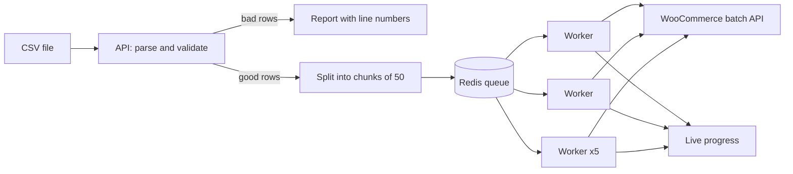

# Catalog Sync

Import thousands of products into WooCommerce from a CSV file, quickly and safely.

The file is validated, split into chunks, and synced by parallel workers while you watch live progress. Bad rows are reported with the exact line and reason instead of failing the whole import.

> An original demo project. It includes a built-in fake WooCommerce store, so you can run the whole thing without WordPress. Point it at a real store by changing three settings.

## The problem

Uploading a large catalog to an online store in one go is slow, and it fails halfway through: one bad row, one timeout, or one rate limit and you're left guessing what made it in. This tool makes imports predictable and repeatable.

## How it works



## Features

- **Row-level validation:** missing SKU, invalid price, sale price above regular price, duplicate SKUs in the file. Every problem is reported with its line number
- **Chunked, parallel processing:** 50 products per chunk, 5 workers at a time (both configurable)
- **One batch request per chunk** instead of one request per product
- **Create or update automatically:** existing SKUs are updated, new ones are created. Running the same file twice gives the same result and creates no duplicates
- **Per-product results:** if the store rejects one product, the other 49 still go through, and the error names the SKU
- **Smart retries:** rate limits (429) and server errors back off and retry, honouring `Retry-After`. Bad credentials fail immediately
- **Chunks that give up are counted as failed**, so an import always reaches a final state instead of hanging
- **Live progress:** percent complete, created, updated, failed, plus the list of problems

## Try it

You need Docker. No WooCommerce store is required.

```bash
docker compose up --build
```

In a second terminal, import the sample file (300 good rows and 4 deliberately broken ones):

```bash
npm install
npm run import -- samples/products.csv
```

You'll see a live progress bar, followed by a summary that looks like this:

```
Import 5f1c...: 300 valid rows, 4 invalid, 6 chunks

[####################] 100%  created 300  updated 0  failed 0

Problems (4):
  -: line 302: sku is required
  SKU-BAD1: line 303: regular_price "ten" is not a valid price
  SKU-0001: line 304: duplicate sku in this file
  SKU-BAD2: line 305: sale_price must be lower than regular_price
```

Now run the same command again. This time it reports `created 0  updated 300`, because the products already exist.

The fake store randomly rejects about 10% of requests with a "slow down" response, so you can watch the retry logic work in the worker logs (`docker compose logs -f worker`). See the store's own counters at `http://localhost:4000/stats`.

No Docker? Install Redis, then run `npm run dev:mock`, `npm run dev:api` and `npm run dev:worker` in three terminals.

You can also upload with plain curl:

```bash
curl -X POST -H "Content-Type: text/csv" --data-binary @samples/products.csv http://localhost:3000/imports
curl http://localhost:3000/imports/<id>
```

## Use it with a real store

In WooCommerce, go to Settings, Advanced, REST API and create a key with Read/Write access. Then set these in your `.env` (copy it from `.env.example`):

```
WOO_BASE_URL=https://your-shop.com
WOO_CONSUMER_KEY=ck_...
WOO_CONSUMER_SECRET=cs_...
```

Try a small file first.

## CSV format

| Column | Required | Notes |
|---|---|---|
| `sku` | yes | Unique per product, up to 100 characters |
| `name` | yes | |
| `regular_price` | yes | Like `19.90` |
| `sale_price` | no | Must be lower than the regular price |
| `stock_quantity` | no | Whole number, defaults to 0 |
| `description` | no | |

## Run the tests

```bash
npm test
```

20 tests, no Redis or accounts needed. They cover the CSV parser (quotes, line breaks, BOM), validation, parallelism limits, create-versus-update logic, partial failures, repeat imports, the retry behaviour, and a full pipeline from CSV to finished progress.

## Project structure

```
src/
  csv.ts          CSV parser
  products.ts     Row validation and WooCommerce payloads
  syncChunk.ts    Sync logic for one chunk (the core)
  woo.ts          WooCommerce client with retries
  progress.ts     Progress tracking (Redis, with an in-memory version for tests)
  server.ts       Upload and status endpoints
  worker.ts       Background workers
  cli.ts          Command-line uploader with progress bar
  mock/           Fake WooCommerce store for demos
```

## Known limits (honest list)

- Existing products are found with one lookup per SKU (a few at a time). Fine for thousands of rows. For hundreds of thousands, cache the SKU-to-ID mapping or use a bulk export.
- Imports run unauthenticated in this demo. Add your own authentication before exposing it.
- Only simple products are supported. Variations, categories and images would be the next additions.

## Tech stack

Node.js 20, TypeScript, Express, BullMQ, Redis, Docker, built-in `node:test`

## Need something like this?

I build reliable integrations between Shopify, WooCommerce, HubSpot, Dynamics 365 and other business tools.
[LinkedIn](https://www.linkedin.com/in/astha-p-shukla-b398b2213) · astha.61097@gmail.com
